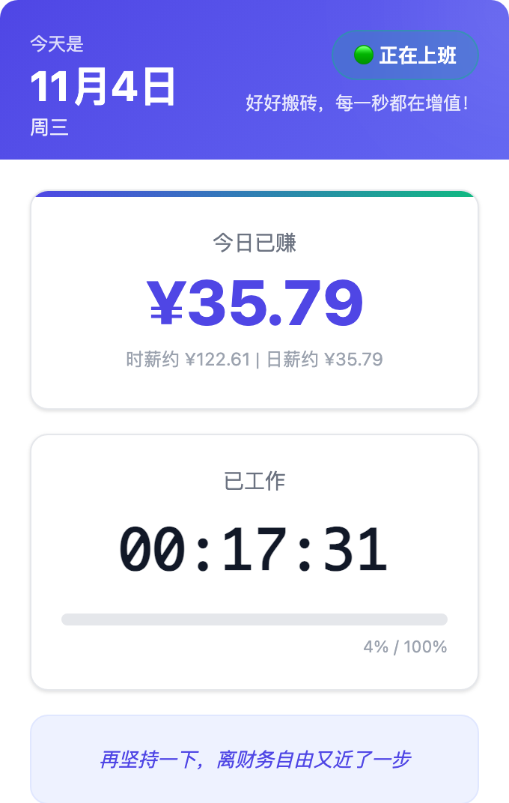

# 💰 上班鼓励器 · Work Encouragement

> 每敲一次键盘，存款就多一分钱。

一个 Chrome 扩展，把工资换算成**秒**。点开浏览器工具栏，看一眼今天已经赚了多少、还要坐多久——上班这件事，突然就有了进度条。



---

## ✨ 功能

| 功能 | 说明 |
| --- | --- |
| **今日已赚** | 按秒滚动累加，金额实时跳动，精确到分 |
| **工作计时器** | `HH:MM:SS`，自动跳过午休，下班后定格为当日总时长 |
| **当前状态** | 🟢 正在上班 / 🟡 午休中 / 🔴 未上班 / 🔴 已下班，附一句对应鼓励语 |
| **今日进度** | 进度条展示当日工作完成度，随时知道「还有百分之几」 |
| **激励语录** | 内置 10 条，可自定义每行一条，随机轮换 |
| **数据持久化** | 按天存储，切换标签页、关掉浏览器、第二天打开，数据都还在 |
| **配置云同步** | 设置存 `chrome.storage.sync`，换设备登录同一账号即可同步 |

所有计算都在本地完成：**不上传、不联网、不收集任何数据**。

---

## 📦 安装

扩展未上架 Chrome 应用商店，用开发者模式加载即可（约 30 秒）：

1. 下载或克隆本仓库到本地
2. 打开 Chrome，地址栏输入 `chrome://extensions/`
3. 右上角打开 **开发者模式**
4. 点击 **加载已解压的扩展程序**，选择本仓库根目录
5. 工具栏出现 💰 图标，点击即可使用；建议点「图钉」固定

> Edge 同理：`edge://extensions/` → 开发人员模式 → 加载解压缩的扩展。

---

## 🎛 首次配置

点击弹窗底部 **⚙ 设置**（或右键图标 → 选项），填写：

| 配置项 | 默认值 | 说明 |
| --- | --- | --- |
| 月薪 | `20000` | 用于推算时薪，税前即可 |
| 月工作天数 | `21.75` | 法定标准，可改为实际值（如双休按 21.75、单休填 26） |
| 货币符号 | `¥` | 显示在金额前 |
| 上班时间 | `09:00` | 计时起点 |
| 下班时间 | `18:00` | 计时终点 |
| 午休开始 | `12:00` | 午休不计入工作时长 |
| 午休结束 | `13:30` | 午休不计入工作时长 |
| 激励语录 | 内置 10 条 | 每行一条，留空恢复默认 |

**计算方式：**

```
日工作时长 = 下班时间 − 上班时间 − 午休时长
时薪       = 月薪 ÷ 月工作天数 ÷ 日工作时长
今日已赚   = 已工作小时数 × 时薪
```

举例：月薪 20000、21.75 天、9:00–18:00（午休 1.5h）→ 日工作时长 7.5h，时薪约 **¥122.6**，每秒约 **¥0.034**。

---

## 📁 项目结构

```
work-encouragement-extension/
├── manifest.json     # Manifest V3 配置（权限、入口、图标）
├── popup.html        # 弹窗界面
├── popup.css         # 弹窗样式
├── popup.js          # 核心逻辑：状态判定、计时、工资换算、每日存储
├── background.js     # Service Worker：每分钟后台落盘，避免数据丢失
├── options.html      # 设置页
├── options.css       # 设置页样式
├── options.js        # 设置读写与校验
├── icons/            # 16 / 32 / 48 / 128 图标
└── docs/
    └── screenshot.png
```

---

## 🔧 实现要点

- **无框架、零依赖**：原生 HTML/CSS/JS，整包不到 40 KB，点击瞬间打开，不用等加载。
- **按秒刷新但不闪烁**：数字用 `tabular-nums` 等宽对齐，金额变化时不会左右抖动。
- **跨午休正确计时**：先判断当前处于「上班前 / 工作时段 / 午休 / 下班后」四种区间，再分别减去已跨越的午休段落，因此上午、午休、下午、下班后四个阶段的数字都能对上。
- **后台兜底**：`chrome.alarms` 每分钟触发一次写入 `chrome.storage.local`，即使弹窗一直没打开，数据也不会丢。
- **按天归档**：存储键为 `YYYY-MM-DD`，每天自然从 0 开始，历史数据保留在 storage 中，便于后续做「周/月统计」。
- **无障碍**：支持 `prefers-reduced-motion`（关闭动画），语义化标签 + 键盘可达。

---

## ❓ 常见问题

**Q：金额为什么和我实际到手的不一样？**
A：这里算的是按约定薪资折算的「时间价值」，不是税后实发。想更贴近到手工资，把月薪填成税后金额即可。

**Q：午休还在跑时间吗？**
A：不会。午休时段计时器冻结、金额停止增长，状态显示「午休中」。如果你午休也在干活，把午休起止时间设成同一时刻即可。

**Q：数据会传到服务器吗？**
A：不会。全部保存在浏览器本地，扩展没有申请任何网络权限。

**Q：换电脑数据还在吗？**
A：设置在 `chrome.storage.sync` 会随账号同步；当日进度存在 `local`，不跨设备。

**Q：想每天重置一次怎么办？**
A：不需要手动重置——存储键按日期生成，第二天自动从零开始。

---

## 🗺 Roadmap

- [ ] 下班倒计时（还有多久可以走）
- [ ] 周薪 / 月薪累计曲线
- [ ] 加班倍率（工作日晚 / 周末）
- [ ] 历史数据导出 CSV
- [ ] 图标徽章实时显示今日金额

---

## 📄 License

MIT
