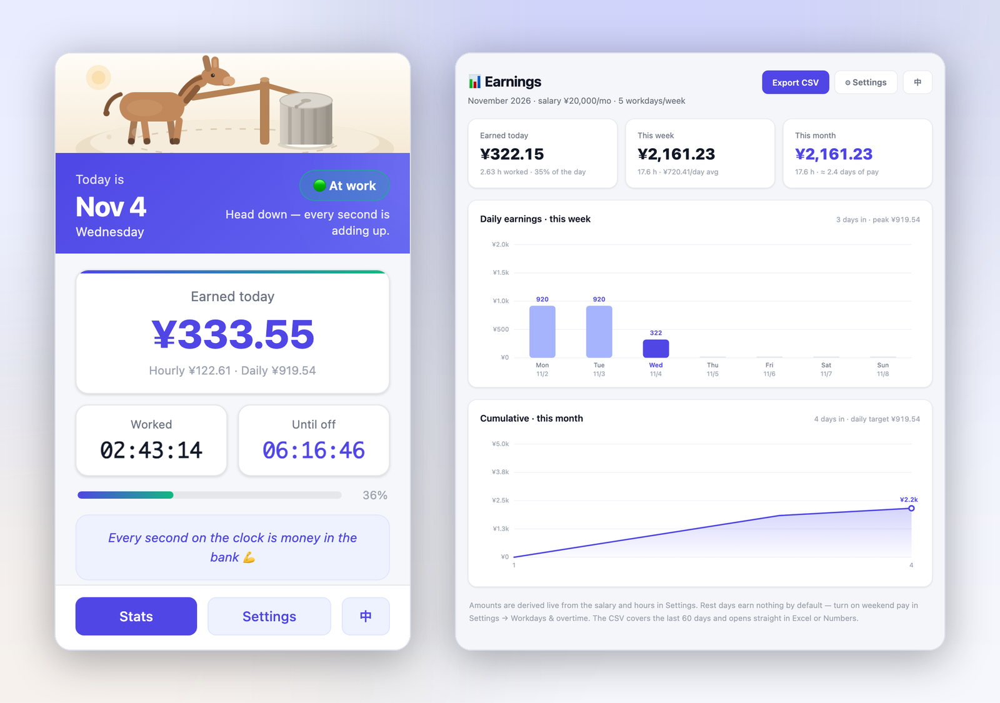
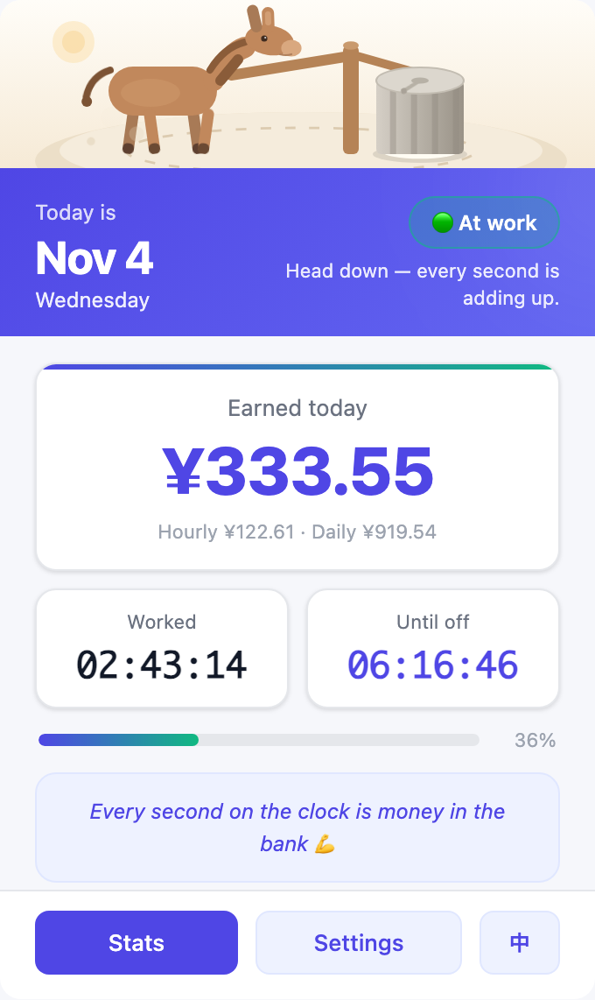
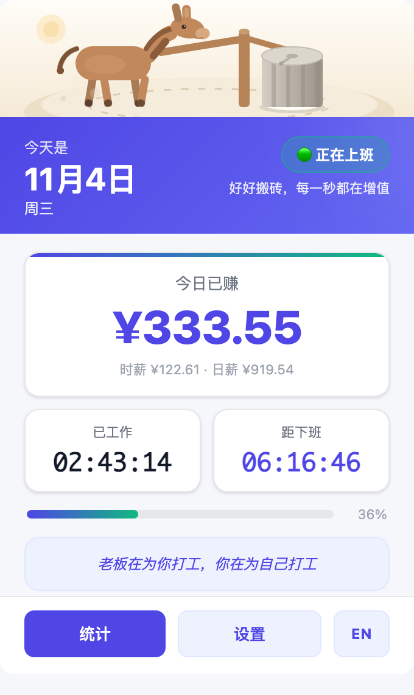
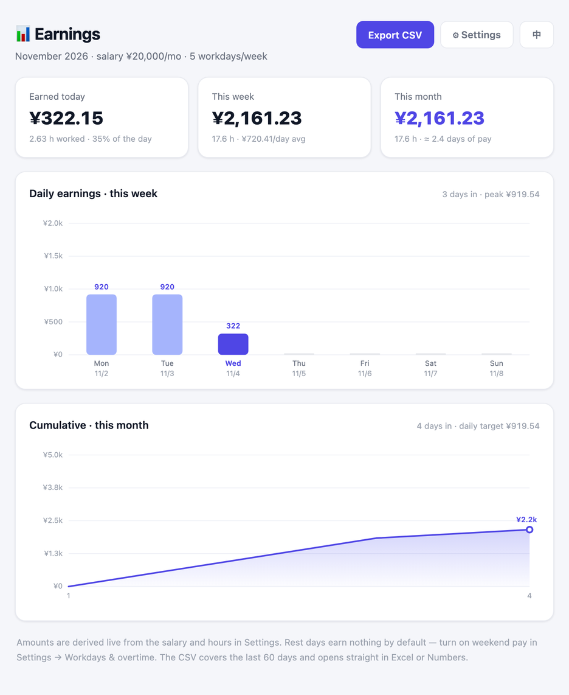
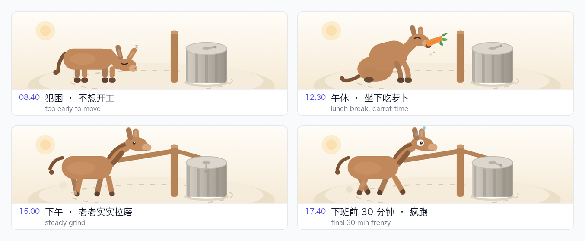

# 💰 Work Encourager · 上班鼓励器

> Every keystroke drops another coin in the jar. · 每敲一次键盘，存款就多一分钱。

A Chrome extension that turns your salary into **seconds**. Click the toolbar icon and see what you've earned today, how long until you're free — work suddenly comes with a progress bar. There's also a donkey up top that changes its mood with the clock, because that's the job.

一个把工资换算成**秒**的 Chrome 扩展。点开工具栏，看一眼今天已经赚了多少、还有多久能走——上班这件事，突然就有了进度条。顶部那头驴会按时间换姿势：早上犯困、午休吃萝卜、下午拉磨、下班前疯跑。

**English is the default UI. 中文一键切换。**



<details>
<summary>查看界面大图／View full-size screenshots</summary>

**English（默认）**



**中文**



**统计页 / Dashboard**



</details>

---

## 🌐 语言 / Language

| | |
| --- | --- |
| 默认语言 | **English** |
| 切换方式 | 弹窗右下角「中 / EN」按钮 · 统计页右上角 · 设置页顶部 Language 卡片 |
| 生效范围 | 弹窗、统计页、设置页、徽章悬停提示，切换后立即刷新，无需重启 |
| 记忆方式 | 写入 `chrome.storage.sync`，换设备跟着账号走 |
| 工具栏名称 | 跟随浏览器语言（`_locales/en` + `_locales/zh_CN`） |

所有文案集中在 `lib/i18n.js` 一张表里，新增语言只要加一个 key 区块；页面用 `data-i18n` 标记，运行时统一填充，不需要维护两份 HTML。

---

## ✨ 功能

| 功能 | 说明 |
| --- | --- |
| **今日已赚** | 按秒滚动累加，金额实时跳动，精确到分 |
| **下班倒计时** | 距离下班还剩多少，精确到秒；上班前显示「距上班」，加班时切换为「加班时长」 |
| **工作计时器** | `HH:MM:SS`，自动跳过午休，下班后定格为当日总时长 |
| **当前状态** | 🟢 上班 / 🟡 午休 / 🟠 加班 / ⚪ 已下班 / ⚪ 休息日，每种状态配一句鼓励语 |
| **加班倍率** | 工作日晚间加班按 1.5× 计薪，可自定义倍率，最多计 6 小时 |
| **周末倍率** | 休息日进公司也能算钱，默认 2×，可开关 |
| **周 / 月曲线** | 独立统计页：本周每日柱状图 + 本月累计折线图 + 今日/本周/本月三档汇总 |
| **CSV 导出** | 一键导出最近 60 天明细（日期、星期、工时、加班、收入、时薪），Excel 可直接打开 |
| **图标徽章** | 不用点开，工具栏图标上直接显示今日已赚金额，每分钟刷新 |
| **激励语录** | 中英各内置 10 条，可自定义每行一条，随机轮换 |
| **中英双语** | 默认英文，弹窗内一键切中文，全站同步 |
| **多币种** | 人民币（默认）/ 美元 / 日元 / 韩元 / 瑞士法郎，切单位自动换算月薪与所有金额 |
| **驴拉磨动画** | 顶部 340×96 的内联 SVG 场景，按时间段切换四种姿态：犯困 / 吃萝卜 / 拉磨 / 疯跑 |
| **配置云同步** | 设置存 `chrome.storage.sync`，换设备登录同一账号即可同步 |

所有计算都在本地完成：**不上传、不联网、不收集任何数据**。

---

## 📦 安装

**方式一：下载安装包（推荐）**

到 [Releases](https://github.com/Susie-ss/work-encouragement-extension/releases/latest) 下载 `work-encouragement-extension-v1.4.0.zip`，解压后得到一个文件夹，然后：

1. 打开 Chrome，地址栏输入 `chrome://extensions/`
2. 右上角打开 **开发者模式**
3. 点击 **加载已解压的扩展程序**，选中解压出来的文件夹（不是 zip）
4. 工具栏出现 💰 图标，点击即可使用；建议点「图钉」固定

**方式二：克隆仓库**

```bash
git clone https://github.com/Susie-ss/work-encouragement-extension.git
```

同样用「加载已解压的扩展程序」选中仓库根目录即可。

> Edge 同理：`edge://extensions/` → 开发人员模式 → 加载解压缩的扩展。

---

## 🎛 首次配置

点击弹窗底部 **⚙ 设置 / Settings**（或右键图标 → 选项）：

| 配置项 | 默认值 | 说明 |
| --- | --- | --- |
| Language | `English` | 切换后立即生效 |
| 月薪 | `20000` | 用于推算时薪，税前税后按你的口径 |
| 月工作天数 | `21.75` | 法定标准；双休 21.75、单休可填 26 |
| 货币单位 | `CNY` 人民币 | 可选 CNY / USD / JPY / KRW / CHF，切换时月薪自动按汇率换算 |
| 汇率 | 内置参考价 | 1 单位外币 = ? 元，可改成当天实际汇率；人民币不显示此项 |
| 上班 / 下班时间 | `09:00` / `18:00` | 计时窗口 |
| 午休 | `12:00` – `13:30` | 不计入工时，金额与倒计时同步暂停 |
| 工作日 | 周一至周五 | 勾选的日子按标准工时计薪，其余视为休息日 |
| 下班后计加班 | 关 | 开启后超过下班时间按倍率累加，最多 6 小时 |
| 工作日晚加班倍率 | `1.5` | 1–5 之间可调 |
| 休息日计薪 | 开 | 休息日进入工时窗口即按倍率计薪 |
| 周末倍率 | `2.0` | 1–5 之间可调 |
| 激励语录 | 内置 10 条 | 每行一条，留空恢复当前语言的内置语录 |

**计算方式：**

```
日工作时长 = 下班时间 − 上班时间 − 午休时长
时薪       = 月薪 ÷ 月工作天数 ÷ 日工作时长
今日已赚   = 正常工时 × 时薪
           + 加班时长 × 时薪 × 加班倍率     （工作日晚，可选）
           + 休息日工时 × 时薪 × 周末倍率   （休息日，可选）
```

举例：月薪 20000、21.75 天、9:00–18:00（午休 1.5h）→ 日工作时长 7.5h，时薪约 **¥122.61**，日薪 **¥919.54**，每秒约 **¥0.034**。

---

## 💱 多币种

月薪输入框的标签后面带一个单位标记（`CNY` / `USD` / `JPY` / `KRW` / `CHF`），下面就是货币下拉框，默认**人民币**：

| 单位 | 符号 | 内置参考汇率（1 单位 = ? 元） |
| --- | --- | --- |
| CNY 人民币 | `¥` | 1 |
| USD 美元 | `$` | 7.10 |
| JPY 日元 | `JP¥` | 0.0475 |
| KRW 韩元 | `₩` | 0.00515 |
| CHF 瑞士法郎 | `CHF` | 8.90 |

- **切单位即换算**：把当前月薪按新旧汇率换成新单位——20000 元 ↔ 2816.9 美元 ↔ 421052 日元——弹窗、统计页、CSV、图标徽章全部跟着变，不用重新填一遍数字。
- **汇率可改**：选非人民币单位时会多出一个「汇率」输入框（`1 USD = ? 元`），内置价只是参考，按当天实际汇率改一下更准。
- **取整规则**：人民币 / 日元 / 韩元按整数，美元 / 法郎保留两位小数；来回切换不会「越换越少」。
- **本地换算**：扩展没有申请网络权限，汇率是静态参考值 + 你手填的值，金额不会发到任何服务器。

---

## 📊 统计页

点击弹窗的 **📊 统计 / Stats** 打开：

- **三档汇总**：今日已赚 / 本周累计 / 本月累计，附工时与日均
- **本周柱状图**：周一到周日每天的收入，今天高亮，峰值单独标注
- **本月累计曲线**：从 1 号到今天的累计收入走势，面积图 + 当前值标记
- **导出 CSV**：文件名随语言变化（`work-encourager_earnings_YYYY-MM-DD.csv` / `上班鼓励器_收入明细_YYYY-MM-DD.csv`），带 UTF-8 BOM，Excel 打开不乱码

> 关于口径：历史收入是按当前配置**反推**的（标准工时 × 时薪），不是逐日打卡记录。所以调整月薪后，往期图表会跟着变——它衡量的是「这段时间的时间价值」，而不是银行流水。

---

## 🐴 顶部那头驴

一条 96px 高的暖色场景，纯内联 SVG + CSS 关键帧，没有图片、没有 GIF、没有 canvas。**它按时间节点换姿势**：



| 时段 | 姿态 | 细节 |
| --- | --- | --- |
| 上班前 / 下班后 | **犯困** | 眼睛闭上、耳朵耷拉、头顶冒 Zzz，拉杆卸下，石碾静止 |
| 午休 · 休息日 | **吃萝卜** | 坐下，张嘴啃胡萝卜，碎屑往下掉，眼睛眯成一条缝 |
| 工作时段 | **正常拉磨** | 对角步态慢慢走，拉杆带着石碾转，蹄下扬尘 |
| 下班前 30 分钟 | **疯跑** | 步频翻倍、步幅拉到 ±30°，整头驴轻微抖动，瞪眼 + 蓝色汗滴乱飞，石碾飞转 |

判定只看两个值：当前状态和距下班的秒数——`countdown ∈ (0, 30min]` 且正在上班就切「疯跑」，午休 / 休息日切「吃萝卜」，其余工作时间「拉磨」，剩下「犯困」。

同一套场景里的动效：

| 部位 | 动效 |
| --- | --- |
| 四条腿 | 对角步态，以腿根为轴前后摆，前后腿反相（`transform-box: fill-box`） |
| 尾巴 | 左右轻摆，疯跑时抖得更快 |
| 石碾身 | 竖向石纹 `translateX(-12px)` 循环滚动，看起来像碾子在转 |
| 石碾顶 | 径向刻痕绕中心自转 |
| 磨道 | 虚线 `stroke-dashoffset` 流动，暗示一直绕圈 |
| 蹄下 | 三团扬尘升起淡出 |

整段约 6 KB，系统开启「减弱动态效果」时会自动定格。

---

## 📁 项目结构

```
work-encouragement-extension/
├── manifest.json          # Manifest V3（__MSG__ 占位符 + default_locale）
├── lib/
│   ├── calc.js            # 单一计算内核：工时窗口、状态、倍数、区间汇总
│   └── i18n.js            # 中英文案表、data-i18n 应用器、内置语录
├── _locales/
│   ├── en/messages.json   # 工具栏名称与商店描述（英文）
│   └── zh_CN/messages.json
├── popup.html/css/js      # 弹窗：驴拉磨、已赚金额、倒计时、计时器、进度、语录
├── dashboard.html/css/js  # 统计页：柱状图、折线图、CSV 导出
├── options.html/css/js    # 设置页：语言、薪资、工时、工作日、倍率、语录
├── background.js          # Service Worker：图标徽章每分钟刷新
├── icons/                 # 16 / 32 / 48 / 128 图标
└── docs/
    ├── cover.png
    ├── ui-popup-en.png
    ├── ui-popup-zh.png
    ├── ui-dashboard.png
    └── ui-donkey-phases.png
```

---

## 🔧 实现要点

- **单一计算内核**：`lib/calc.js` 以 ES module 形式被 popup、统计页、设置页和 service worker 同时 `import`，保证「弹窗看到的金额」和「统计页画出的柱子」用的是同一套算法，不会各算各的。
- **单一文案表**：`lib/i18n.js` 集中管理两套文案，页面只写 key（`data-i18n="salary.label"`），运行时统一填充；带变量的文案走 `t(lang, key, vars)`，避免拼接字符串。
- **无框架、零依赖**：原生 HTML/CSS/JS + 手写 SVG 图表 + 手写 SVG 动画，整包不到 70 KB，点击瞬间打开，不用等加载。
- **按秒刷新但不抖动**：数字用 `tabular-nums` 等宽对齐，金额变化时不会左右跳动。
- **跨午休正确计时**：把一天切成「上班前 / 工作 / 午休 / 加班 / 下班后」几个区间，按已跨越的段落分别扣减，四个阶段的数字都能对上。
- **倍率只作用于增量**：加班只算超过下班时间的那段（上限 6 小时），标准工时永远按 1×，避免倍率污染日薪。
- **徽章轻量刷新**：`chrome.alarms` 每分钟唤醒一次 service worker 调 `chrome.action.setBadgeText`，不常驻后台。
- **四姿态只有一条时间轴**：`millPhase(status, stat)` 只读「当前状态 + 距下班秒数」两个值，写进 `data-phase`；画面上三头驴（走路 / 犯困 / 吃萝卜）始终都在 DOM 里，靠 CSS 选择器显隐，切换时不需要重绘 SVG。且只在值变化时才写属性，否则每秒重设会让 CSS 动画跳回第 0 帧。
- **无障碍**：支持 `prefers-reduced-motion`（关闭动画）、语义化标签、键盘可达、开关有可见焦点环。

---

## ❓ 常见问题

**Q：金额为什么和我实际到手的不一样？**
A：这里算的是按约定薪资折算的「时间价值」，不是税后实发。想更贴近到手工资，把月薪填成税后金额即可。

**Q：怎么切换成中文？**
A：弹窗右下角点一下「中」，整站立刻变中文；统计页右上角、设置页顶部的 Language 卡片也能切。选择会跟着 Chrome 账号同步。

**Q：工资是美元 / 日元，怎么填？**
A：设置页「薪资设置」里把货币单位切成对应币种，汇率框填当天汇率，再填月薪数字即可。之后切回人民币会自动换算出等值金额，弹窗、统计页、CSV 一起变，不用重算。

**Q：工具栏名字为什么不跟着切换？**
A：工具栏名称由 `_locales` 按**浏览器语言**决定（Chrome 的规则，扩展无法在运行时改）。界面语言则是应用内自己管的，两者独立；把 Chrome 语言设成中文即可让名称也显示「上班鼓励器」。

**Q：午休还在跑时间吗？**
A：不会。午休时段计时器冻结、金额停止增长、倒计时不动，状态显示「午休中」。午休也在干活的话，把午休起止设成同一时刻即可。

**Q：加班怎么才算进去？**
A：默认不算。到「设置 → 工作日与加班」打开「下班后继续计加班」，超过下班时间就按倍率累加，最多 6 小时，状态变成「🟠 加班中」。

**Q：周末来加班能算钱吗？**
A：默认开启。休息日只要落在工时窗口内就按 2× 计薪；不想算就关掉「休息日加班计薪」，状态会显示「休息日」。

**Q：数据会传到服务器吗？**
A：不会。全部保存在浏览器本地，扩展没有申请任何网络权限。

**Q：换电脑数据还在吗？**
A：设置（薪资、工时、倍率、语言）走 `chrome.storage.sync`，会随 Chrome 账号同步；今日进度是实时算出来的，不依赖本地历史。

**Q：想每天重置一次怎么办？**
A：不需要手动重置——日期一变，金额和计时器自动从零开始。

**Q：徽章上的数字太小/太挤？**
A：徽章最多显示 4 个字符，超过 1000 会自动显示成 `1.2k` 这类缩写，鼠标悬停图标可看到精确金额。

**Q：驴怎么一直犯困？什么时候才会跑起来？**
A：它跟着时钟走——上班前和下班后犯困，午休和休息日吃萝卜，正常工作时段拉磨，**只有下班前 30 分钟**才疯跑。想立刻看效果，把「下班时间」临时改到 30 分钟内即可；系统开了「减弱动态效果」时会统一定格，不再跑动。

---

## 🗺 Roadmap

- [x] 下班倒计时（还有多久可以走）
- [x] 周薪 / 月薪累计曲线
- [x] 加班倍率（工作日晚 / 周末）
- [x] 历史数据导出 CSV
- [x] 图标徽章实时显示今日金额
- [x] 中英双语（默认英文，可切换）
- [x] 顶部驴拉磨动画
- [x] 驴按时段换姿态（犯困 / 吃萝卜 / 拉磨 / 下班前疯跑）
- [x] 多币种（人民币 / 美元 / 日元 / 韩元 / 瑞郎，切单位自动换算）
- [ ] 法定节假日日历（自动跳过调休）
- [ ] 多套薪资方案切换（主业 / 副业）
- [ ] 桌面通知：下班前 10 分钟提醒

---

## 📄 License

MIT
