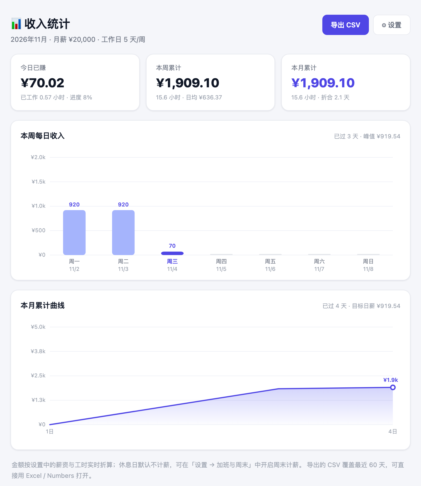

# 💰 上班鼓励器 · Work Encouragement

> 每敲一次键盘，存款就多一分钱。

一个 Chrome 扩展，把工资换算成**秒**。点开浏览器工具栏，看一眼今天已经赚了多少、还有多久能走——上班这件事，突然就有了进度条。




---

## ✨ 功能

| 功能 | 说明 |
| --- | --- |
| **今日已赚** | 按秒滚动累加，金额实时跳动，精确到分 |
| **下班倒计时** | 距离下班还剩多少，精确到秒；上班前显示「距上班」，加班时切换为「加班时长」 |
| **工作计时器** | `HH:MM:SS`，自动跳过午休，下班后定格为当日总时长 |
| **当前状态** | 🟢 上班 / 🟡 午休 / 🟠 加班 / ⚪ 已下班 / ⚪ 休息日，每种状态配一句鼓励语 |
| **加班倍率** | 工作日晚间加班按 1.5× 计薪，可自定义倍率，最多计 6 小时 |
| **周末倍率** | 休息日进公司也能算钱，默认 2×，可开关 |
| **周 / 月曲线** | 独立统计页：本周每日柱状图 + 本月累计折线图 + 今日/本周/本月三档汇总 |
| **CSV 导出** | 一键导出最近 60 天明细（日期、星期、工时、加班、收入、时薪），Excel 可直接打开 |
| **图标徽章** | 不用点开，工具栏图标上直接显示今日已赚金额，每分钟刷新 |
| **激励语录** | 内置 10 条，可自定义每行一条，随机轮换 |
| **配置云同步** | 设置存 `chrome.storage.sync`，换设备登录同一账号即可同步 |

所有计算都在本地完成：**不上传、不联网、不收集任何数据**。

---

## 📦 安装

扩展未上架 Chrome 应用商店，用开发者模式加载即可（约 30 秒）：

1. 下载或克隆本仓库到本地
2. 打开 Chrome，地址栏输入 `chrome://extensions/`
3. 右上角打开 **开发者模式**
4. 点击 **加载已解压的扩展程序**，选择本仓库根目录
5. 工具栏出现 💰 图标，点击即可使用；建议点「图钉」固定

> Edge 同理：`edge://extensions/` → 开发人员模式 → 加载解压缩的扩展。

---

## 🎛 首次配置

点击弹窗底部 **⚙ 设置**（或右键图标 → 选项）：

| 配置项 | 默认值 | 说明 |
| --- | --- | --- |
| 月薪 | `20000` | 用于推算时薪，税前税后按你的口径 |
| 月工作天数 | `21.75` | 法定标准；双休 21.75、单休可填 26 |
| 货币符号 | `¥` | 显示在金额前 |
| 上班 / 下班时间 | `09:00` / `18:00` | 计时窗口 |
| 午休 | `12:00` – `13:30` | 不计入工时，金额与倒计时同步暂停 |
| 工作日 | 周一至周五 | 勾选的日子按标准工时计薪，其余视为休息日 |
| 下班后计加班 | 关 | 开启后超过下班时间按倍率累加，最多 6 小时 |
| 工作日晚加班倍率 | `1.5` | 1–5 之间可调 |
| 休息日计薪 | 开 | 休息日进入工时窗口即按倍率计薪 |
| 周末倍率 | `2.0` | 1–5 之间可调 |
| 激励语录 | 内置 10 条 | 每行一条，留空恢复默认 |

**计算方式：**

```
日工作时长 = 下班时间 − 上班时间 − 午休时长
时薪       = 月薪 ÷ 月工作天数 ÷ 日工作时长
今日已赚   = 正常工时 × 时薪
           + 加班时长 × 时薪 × 加班倍率     （工作日晚，可选）
           + 休息日工时 × 时薪 × 周末倍率   （休息日，可选）
```

举例：月薪 20000、21.75 天、9:00–18:00（午休 1.5h）→ 日工作时长 7.5h，时薪约 **¥122.61**，日薪 **¥919.54**，每秒约 **¥0.034**。

---

## 📊 统计页

点击弹窗的 **📊 统计** 打开：

- **三档汇总**：今日已赚 / 本周累计 / 本月累计，附工时与日均
- **本周柱状图**：周一到周日每天的收入，今天高亮，峰值单独标注
- **本月累计曲线**：从 1 号到今天的累计收入走势，面积图 + 当前值标记
- **导出 CSV**：`上班鼓励器_收入明细_YYYY-MM-DD.csv`，带 UTF-8 BOM，Excel 打开不乱码

> 关于口径：历史收入是按当前配置**反推**的（标准工时 × 时薪），不是逐日打卡记录。所以调整月薪后，往期图表会跟着变——它衡量的是「这段时间的时间价值」，而不是银行流水。

---

## 📁 项目结构

```
work-encouragement-extension/
├── manifest.json      # Manifest V3 配置（权限、入口、图标、ESM worker）
├── lib/
│   └── calc.js        # 单一计算内核：工时窗口、状态、倍数、区间汇总
├── popup.html/css/js  # 弹窗：已赚金额、倒计时、计时器、进度、语录
├── dashboard.html/css/js  # 统计页：柱状图、折线图、CSV 导出
├── options.html/css/js    # 设置页：薪资、工时、工作日、倍率、语录
├── background.js      # Service Worker：图标徽章每分钟刷新
├── icons/             # 16 / 32 / 48 / 128 图标
└── docs/
    ├── screenshot.png
    └── dashboard.png
```

---

## 🔧 实现要点

- **单一计算内核**：`lib/calc.js` 以 ES module 形式被 popup、统计页、设置页和 service worker 同时 `import`，保证「弹窗看到的金额」和「统计页画出的柱子」用的是同一套算法，不会各算各的。
- **无框架、零依赖**：原生 HTML/CSS/JS + 手写 SVG 图表，整包不到 60 KB，点击瞬间打开，不用等加载。
- **按秒刷新但不抖动**：数字用 `tabular-nums` 等宽对齐，金额变化时不会左右跳动。
- **跨午休正确计时**：把一天切成「上班前 / 工作 / 午休 / 加班 / 下班后」几个区间，按已跨越的段落分别扣减，四个阶段的数字都能对上。
- **倍率只作用于增量**：加班只算超过下班时间的那段（上限 6 小时），标准工时永远按 1×，避免倍率污染日薪。
- **徽章轻量刷新**：`chrome.alarms` 每分钟唤醒一次 service worker 调 `chrome.action.setBadgeText`，不常驻后台。
- **无障碍**：支持 `prefers-reduced-motion`（关闭动画）、语义化标签、键盘可达、开关有可见焦点环。

---

## ❓ 常见问题

**Q：金额为什么和我实际到手的不一样？**
A：这里算的是按约定薪资折算的「时间价值」，不是税后实发。想更贴近到手工资，把月薪填成税后金额即可。

**Q：午休还在跑时间吗？**
A：不会。午休时段计时器冻结、金额停止增长、倒计时不动，状态显示「午休中」。午休也在干活的话，把午休起止设成同一时刻即可。

**Q：加班怎么才算进去？**
A：默认不算。到「设置 → 工作日与加班」打开「下班后继续计加班」，超过下班时间就按倍率累加，最多 6 小时，状态变成「🟠 加班中」。

**Q：周末来加班能算钱吗？**
A：默认开启。休息日只要落在工时窗口内就按 2× 计薪；不想算就关掉「休息日加班计薪」，状态会显示「休息日」。

**Q：数据会传到服务器吗？**
A：不会。全部保存在浏览器本地，扩展没有申请任何网络权限。

**Q：换电脑数据还在吗？**
A：设置（薪资、工时、倍率）走 `chrome.storage.sync`，会随 Chrome 账号同步；今日进度是实时算出来的，不依赖本地历史。

**Q：想每天重置一次怎么办？**
A：不需要手动重置——日期一变，金额和计时器自动从零开始。

**Q：徽章上的数字太小/太挤？**
A：徽章最多显示 4 个字符，超过 1000 会自动显示成 `1.2k` 这类缩写，鼠标悬停图标可看到精确金额。

---

## 🗺 Roadmap

- [x] 下班倒计时（还有多久可以走）
- [x] 周薪 / 月薪累计曲线
- [x] 加班倍率（工作日晚 / 周末）
- [x] 历史数据导出 CSV
- [x] 图标徽章实时显示今日金额
- [ ] 法定节假日日历（自动跳过调休）
- [ ] 多套薪资方案切换（主业 / 副业）
- [ ] 桌面通知：下班前 10 分钟提醒

---

## 📄 License

MIT
